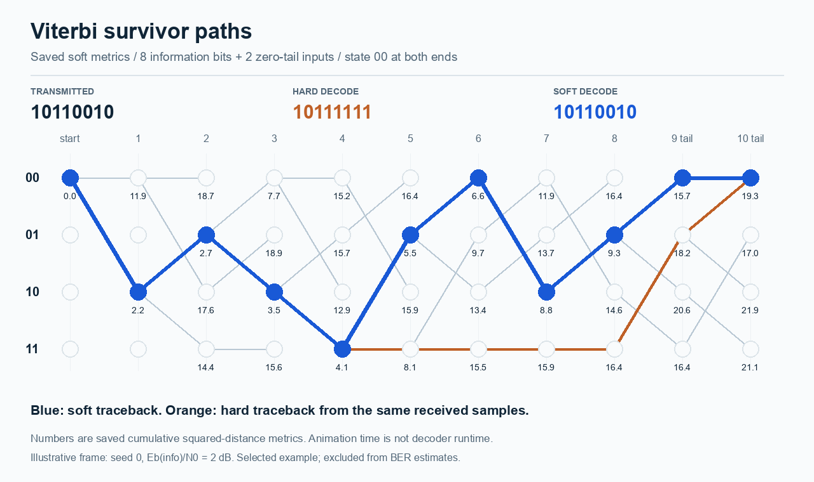
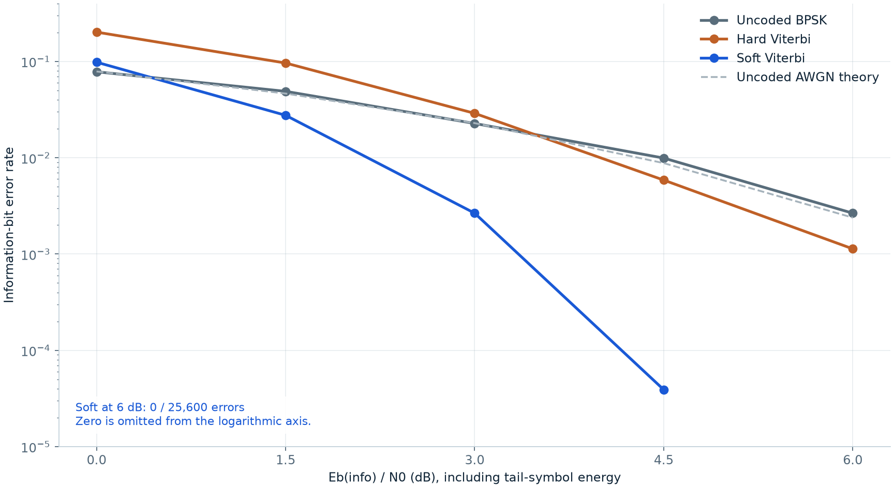

# Convolutional coding lab

A source-built, terminated **K=3, rate-1/2 convolutional encoder** with generators **(7,5) in octal**, plus full-frame hard and soft Viterbi decoding. A reproducible simulation compares both decoders with uncoded BPSK at equal information-bit `Eb/N0`, including termination energy.

The implementation uses the Python standard library. NumPy, Matplotlib and Pillow are used only to render evidence. All bits and channel samples are synthetic. Code, analysis and documentation were created with AI assistance; this is a simulation study, not a hardware modem measurement.



[Static report](docs/report.html) · [8-second trellis replay](docs/assets/trellis-replay.mp4) · [Measured results](results/published/summary.csv) · [Methodology](docs/methodology.md)

[Six report screenshots](docs/screenshots/README.md) · [Continuous automated browser walkthrough](docs/recordings/README.md)

## What is implemented

- Explicit four-state trellis, zero initial state and two zero-tail inputs.
- Hamming-metric hard decoding and squared-Euclidean soft decoding, with deterministic ties and full survivor traceback to final state 00.
- Seeded, independent AWGN frames with exact saved float64 received samples; hard and soft use the same coded observations.
- Per-frame source bits, coded bits, decoded bits, state paths, errors and actual decoder timings.
- Independent exhaustive maximum-likelihood oracles, a hand-computed codeword, boundary tests and artifact reconciliation.

## Measured result

The preserved run uses 400 frames of 64 information bits at each of five `Eb(info)/N0` points: 0, 1.5, 3, 4.5 and 6 dB. There are 2,000 channel frames and 6,000 timed decoder calls.

At 3 dB, errors out of 25,600 information bits were **581 uncoded**, **740 hard Viterbi** and **68 soft Viterbi**. At 0 dB, both coded methods had more bit errors than uncoded BPSK. At 6 dB, soft decoding observed no information-bit errors in this finite run; that is not a zero-error probability claim.



[Findings and limits](docs/findings.md) distinguish information-bit BER, channel-symbol errors, frame-error uncertainty and timing scope.

## Run

Python 3.11 or newer; the measured run used Python 3.13.17. From the repository root:

```sh
python -m pip install -e .
python -m unittest discover -s tests -v
python -m convcode encode 1011
python -m convcode soft results/published/demo.json --trace
```

The hand vector `1011` plus zero tails `00` emits `11 10 00 01 01 11`.

`hard` and `soft` accept a JSON array or an object with a `received` array. Hard input must contain integer bits; soft input contains finite real samples. Encoding emits a JSON object with the coded bits and state path. A four-sample encoded empty payload is valid; simulation energy normalization requires a nonempty information payload.

## Reproduce without replacing published evidence

```sh
python scripts/run_study.py --out outputs/reproduction
python scripts/run_study.py --frames 20 --out outputs/pilot
```

Both commands refuse a nonempty output directory. The default experiment reproduces the published design and deterministic bits; wall-clock timestamps and timing measurements are newly observed. Gaussian generation may differ in final floating-point bits across platform math libraries, so the committed raw samples are the canonical observations.

To rebuild figures and the replay from the preserved run:

```sh
python -m pip install -r requirements.txt
python scripts/build_report.py
python scripts/render_trellis.py
python -m http.server 8000
```

Open `http://localhost:8000/docs/report.html`. The replay renderer additionally requires `ffmpeg` with `libx264` on `PATH`; it produces a silent H.264 MP4. Plot dependencies are pinned to NumPy 2.3.5, Matplotlib 3.11.2 and Pillow 13.0.0. Core tests and simulations need none of those packages.

CI runs 14 tests, generates a separate 100-frame pilot, checks its manifest and preserves the committed run. Tests re-decode all 2,000 stored sample blocks, reconcile every summary and timing record, and verify media hashes. Independent short-frame oracles cover 1,344 hard observations and 120 soft observations; two additional review tests exercise confidence weighting and the known final state.

## Files

| Path | Contents |
|---|---|
| `src/convcode/core.py` | Encoder, modulation, hard/soft Viterbi, energy conversion and Wilson intervals |
| `src/convcode/channel.py` | Frame-local bit and Gaussian seeds |
| `results/published/received.f64` | Actual received samples, IEEE754 little-endian float64 |
| `results/published/frames.csv` | Seeds, byte offsets, payloads, paths and per-frame errors |
| `results/published/measurements.csv` | Actual complete decoder-call durations and randomized order |
| `results/published/summary.csv` | Aggregated information BER, frame error estimates and timing summaries |
| `results/published/demo.json` | Selected short frame with complete survivor metrics and pointers |
| `docs/assets/trellis-replay.json` | Input, script, poster and video hashes |
| `docs/algorithms.md` | State convention, likelihood metrics and primary references |
| `docs/methodology.md` | Seeds, energy, binary layout, uncertainty and timing |

The study is deliberately limited to an ideal synchronized real AWGN channel, one short convolutional code, one payload length and five signal levels. It makes no claims about fading, synchronization, interleaving, puncturing, quantized soft inputs, coding standards or production throughput.
